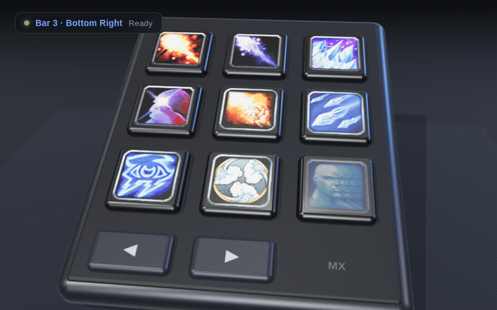

# MX Keypad Sync for World of Warcraft Forever



Syncs World of Warcraft action bars (default: **Action Bar 3 / Bottom Right**, slots `61–72`) to a **Logitech MX Creative Keypad** (`046d:c354`) in real time, displaying each ability's icon, disabled/cooldown/mana/range state, and clockwise **Global Cooldown (GCD)** sweep animation on the keypad's 9 LCD screens.

- **9 LCD Keys:** Slots `1–9` of the active action bar.
- **2 Page Buttons (`◀` / `▶`):** Cycle through all available action bars (Bars `1–5` in Classic/Forever, `1–8` in Retail) with instant cached switching.

## Architecture

1. **[wow-addon/MXKeypadSync](wow-addon/MXKeypadSync/)**: A lightweight WoW Lua addon that encodes the active bar, GCD progress, and 12 slots' `iconFileID` + state flags into a tiny `164×4` pixel strip at the top-left of the screen using a 4-bit-per-channel encoding (immune to Proton/DXVK/compositor color drift).
2. **[companion/](companion/)**: A cross-platform Node.js companion app (works on **Ubuntu Linux** and **Windows**) that captures the pixel strip, fetches & caches WoW BLP2 icons from `wago.tools`, caches bar layouts for instant switching, renders `118×118` icons + GCD sweeps to the MX Keypad over USB HID, and injects keystrokes when keypad buttons are pressed.

---

## 1. Install the WoW Addon

Copy `wow-addon/MXKeypadSync` into your WoW `Interface/AddOns/` folder:

- **Ubuntu (Steam + Proton):**
  Find your WoW `Interface/AddOns` directory inside the Proton prefix (e.g. `~/.local/share/Steam/steamapps/compatdata/<APPID>/pfx/drive_c/Program Files (x86)/World of Warcraft/_retail_/Interface/AddOns/`) and copy or symlink `MXKeypadSync` there.
- **Windows:**
  Copy `MXKeypadSync` into `C:\Program Files (x86)\World of Warcraft\_retail_\Interface\AddOns\MXKeypadSync`.

In-game slash commands:
- `/mxk` — Show current bar and commands
- `/mxk bar <1-8|topright|bottomright|right|main>` — Switch which action bar is synced (default: `3` / `bottomright`)
- `/mxk size <2-16>` — Adjust pixel cell size (default: `4`)
- `/mxk pos <x> <y>` — Adjust top-left offset
- `/mxk dump` — Print the 12 slot icon IDs and flags in chat
- `/mxk bind` — Auto-bind `Ctrl+Shift+F1..F9` (slots) and `Ctrl+Shift+F11/F12` (prev/next bar)

### Bind Keys in WoW

Run `/mxk bind` in WoW chat (out of combat), or bind manually under **Options → Keybindings → AddOns → MX Keypad Sync** to match `companion/config.json` (defaults to `Ctrl+Shift+F1`–`Ctrl+Shift+F9` for slots and `Ctrl+Shift+F11` / `Ctrl+Shift+F12` for cycling bars).

---

## 2. Setup the Companion App

### Ubuntu Linux (udev permissions)

Grant your user access to the MX Keypad (`/dev/hidraw*`) and `/dev/uinput` (for virtual keyboard input on Wayland/Proton):

```bash
sudo tee /etc/udev/rules.d/99-mx-keypad-wow.rules <<'EOF'
SUBSYSTEM=="hidraw", ATTRS{idVendor}=="046d", ATTRS{idProduct}=="c354", MODE="0666"
KERNEL=="uinput", GROUP="input", MODE="0660"
EOF
sudo usermod -aG input "$USER"
sudo udevadm control --reload-rules && sudo udevadm trigger
```
*(Log out and back in if you were just added to the `input` group.)*

### Install & Run

```bash
cd companion
npm install
cp config.example.json config.json   # optional: customize keybindings or captureRegion
npm start
```

- On **Ubuntu GNOME Wayland**, a ScreenCast portal dialog will appear once at startup—select your monitor or the WoW window.
- On **X11 / XWayland** (if `x11grab` is preferred), run: `node src/index.js --capture x11`
- On **Windows**, run `npm start` (make sure Logi Options+ is closed or not claiming the keypad).
